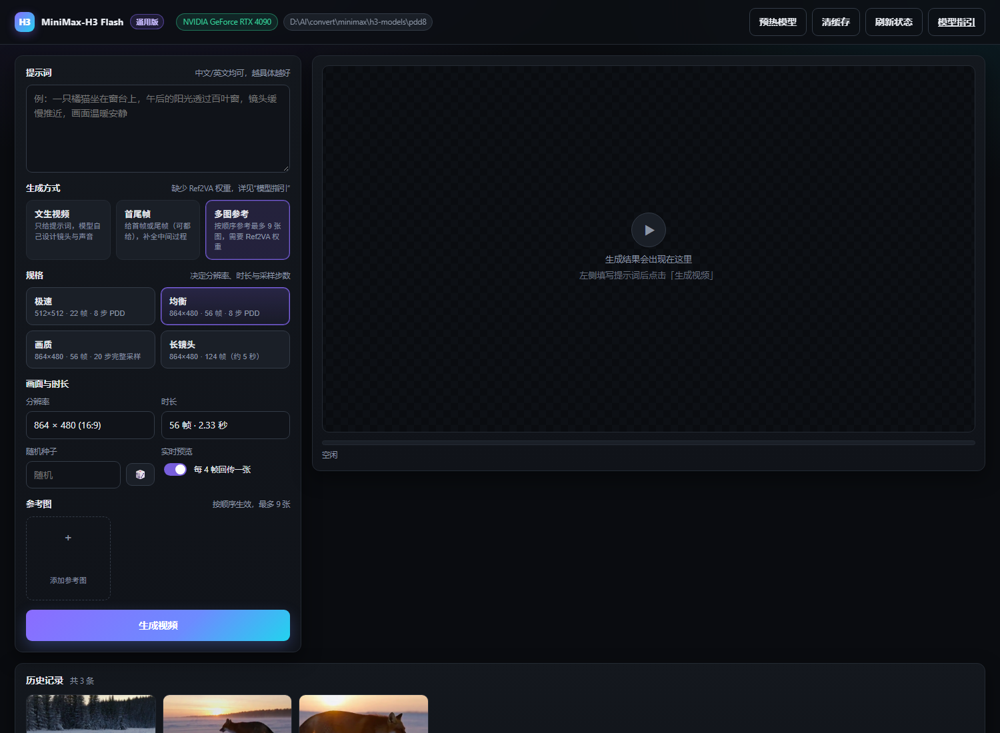

# H3 .NET Runtime (`h3rt`)

[](https://www.nuget.org/packages/H3NetRuntime)
[](LICENSE)
[](https://dotnet.microsoft.com/download/dotnet/8.0)

把 `ComfyUI_MiniMax-H3-V8` 的 MiniMax-H3 / HyperFlow H3 Flash 能力封装成
**不依赖 Python 的原生 C/CUDA 运行库**，再用 .NET P/Invoke 包成 `H3Runtime`，
附带一个开箱即用的本地 WebUI。**不需要 Python、ComfyUI、PyTorch 或 Gradio。**

```
C# / 浏览器                                  模型权重
   │  P/Invoke (JSON ABI)  ┌─ WebUI (ASP.NET Core + 原生 JS)    5 个文件
   ▼                       ▼                                  (本仓库不含)
H3NetRuntime.dll ────── h3rt.dll / libh3rt.so ────────────────► CUDA + FFmpeg
   SafeHandle / async / IProgress / CancellationToken
```

## 它做了什么

- 直接读 `ComfyUI_MiniMax-H3-V8` 发布的 **5 个权重文件**，自动识别
  HyperFlow Flash 的元数据：47 / 49 层 DiT、rank-16 time embedder、
  INT8 ConvRot + 低秩混合精度、内置 sigma 与 gate；
- 提供三种生成模式：**文生视频 `t2v`、首尾帧 `fl2v`、多图参考 `ref2v`**；
- 权重可以散落在任意目录，运行时用硬链接 / 目录联接拼出引擎需要的布局，
  **不复制几十 GB 文件**；
- 控制台打印每个模型组件的**完整解析路径**；WebUI 显示整体进度、阶段耗时与 ETA；
- NuGet 包内带 win-x64 / linux-x64 原生资产，消费方无需部署脚本。

**边界**：加壳的 ComfyUI Python 代码没有被逆向；兼容性是工作流能力级的，
不保证与 ComfyUI 逐像素一致。只服务 MiniMax-H3 / HyperFlow H3 Flash 这一套
模型；上游 `h3-spark.c` 的 Z-Image / Wan2.2 / Qwen-Image 2.1 不通过本 ABI 暴露。


## 内置 Demo（每种模式都能一键上手）

WebUI 的「示例」区按当前模式过滤，点一下即填入提示词、规格和示例素材，
改一两个词就能生成。重点是演示 MiniMax H3 的提示词写法、精确控制与高级运镜。

| 模式 | Demo |
|---|---|
| `t2v` 文生视频 | 写实 + 推镜 / 时间轴精确控制 / 高级运镜：环绕 / 氛围与声音 |
| `fl2v` 首尾帧 | 首帧续写 + 推镜 / 首尾帧过渡（**两条都内置锚点图**） |
| `ref2v` 多图参考 | 主体一致性（内置主体图）/ 多图组合（**内置主体图 + 场景图**） |

素材在 `wwwroot/demo/`，均为仓库内图片，不依赖外部服务。



## 快速开始

### 1. 环境

| | 要求 |
|---|---|
| 系统 | Windows x64 或 Linux x64 |
| GPU | NVIDIA，**算力必须与原生库编译目标一致**（预编译包为 `sm_89`） |
| CUDA | 12.x / 13.x runtime + cuBLAS |
| 工具 | `ffmpeg` / `ffprobe` 在 `PATH`（MP4 封装） |
| .NET | 8.0 SDK（构建 / 运行 WebUI）；原生构建另需 CMake ≥ 3.25、Ninja、MSVC 或 gcc/nvcc |

### 2. 准备五个权重文件

保持 ComfyUI 的原始文件名和目录结构即可，WebUI 会自动发现：

```text
ComfyUI_MiniMax-H3-V8/ComfyUI/models/
├── diffusion_models/
│   ├── minimax_h3_fl2va_hyperflow_flash_int8_convrot.safetensors   ≈15.9 GB
│   └── minimax_h3_ref2va_hyperflow_flash_int8_convrot.safetensors   ≈16.3 GB  (ref2v 才需要)
├── text_encoders/
│   └── qwen3vl-32B-MiniMax-H3-Q4_K_M.gguf                          ≈14.6 GB
└── vae/
    ├── minimax_h3_sol_vae_int8_convrot.safetensors                  ≈1.99 GB
    └── minimax_h3_audio_vae_fp32.safetensors                        ≈605 MB
```

不需要 `config.json`、PDD LoRA 或 `tokenizer.json` —— 层数 / sigma / gate 从
checkpoint metadata 读取，tokenizer 随程序分发。完整下载、校验与排错说明见
[`docs/MODELS.md`](docs/MODELS.md)。

### 3. 启动 WebUI

```bat
scripts\build.cmd                    :: 构建原生库 + .NET 解决方案（89 = RTX 4090）
scripts\run-webui.cmd                :: 通用版  http://127.0.0.1:7867/
scripts\run-webui-advanced.cmd       :: 高级版（全部引擎开关）
```

```bash
bash scripts/build.sh 89             # Linux / WSL
dotnet run --project dotnet/src/H3NetRuntime.WebUI -c Release -- --edition general
```

指定模型位置（优先级从高到低）：`--model-dir` → `H3_MODEL_DIR` →
`h3.config.json` 的 `h3_dir` → 常见默认目录。启动日志会逐行打印解析结果：

```text
模型来源  : D:/models/ComfyUI_MiniMax-H3-V8/ComfyUI/models  (ComfyUI models/ 目录)
  [OK  ] FL2VA DiT      transformer    .../diffusion_models/minimax_h3_fl2va_...safetensors
  [OK  ] 文本编码器     text_encoder   .../text_encoders/qwen3vl-32B-MiniMax-H3-Q4_K_M.gguf
  [OK  ] 视频 VAE       video_vae      .../vae/minimax_h3_sol_vae_int8_convrot.safetensors
  [OK  ] 音频 VAE       audio_vae      .../vae/minimax_h3_audio_vae_fp32.safetensors
```

任务进度按阶段加权汇总、单调不回退，控制台每 5 秒或每跨一个阶段打印一行，
例如 `去噪采样  24/56  72.8%  01:42 · 剩余约 00:39`。

### 4. 在 C# 里调用

```bash
dotnet add package H3NetRuntime
```

```csharp
using H3NetRuntime;

using var cts = new CancellationTokenSource();
using var runtime = H3Runtime.Create(new H3RuntimeOptions
{
    ModelDir = @"D:\models\ComfyUI_MiniMax-H3-V8\ComfyUI\models",
    KeepDit = true
});

Console.WriteLine(runtime.DeviceInfoJson);

var progress = new Progress<H3Progress>(p =>
    Console.WriteLine($"{p.Phase} {p.Completed}/{p.Total}"));

H3GenerateResult clip = await runtime.GenerateAsync(
    new H3GenerateRequest
    {
        Prompt = "A red fox trotting through fresh snow, slow dolly-in, film grain.",
        Width = 768, Height = 448, Frames = 56, Steps = 8, Seed = 42,
        OutputPath = @"D:\out\fox.mp4"
    },
    progress,
    cancellationToken: cts.Token);

Console.WriteLine($"{clip.OutputPath} ({clip.Bytes} bytes)");
```

权重散落时逐组件指定（链接而非复制）：

```csharp
Models = new H3ModelPaths
{
    Transformer      = @"E:\hf\minimax_h3_fl2va_hyperflow_flash_int8_convrot.safetensors",
    Ref2vaTransformer= @"E:\hf\minimax_h3_ref2va_hyperflow_flash_int8_convrot.safetensors",
    TextEncoder      = @"E:\hf\qwen3vl-32B-MiniMax-H3-Q4_K_M.gguf",
    VideoVae         = @"E:\hf\minimax_h3_sol_vae_int8_convrot.safetensors",
    AudioVae         = @"E:\hf\minimax_h3_audio_vae_fp32.safetensors"
},
PackCacheDir = @"E:\hf\.h3rt-packs"
```

`Generate / GenerateAsync` 返回 MP4 路径，支持 `IProgress<H3Progress>`、逐帧 RGB
回调与协作式取消。帧数必须是 `17n+5` 且 ≥ 22（22、39、56、73 … 362），
运行时自动向上对齐；宽高必须是 32 的倍数。

原生库查找顺序：`H3RT_NATIVE_DIR` → 程序目录 → `runtimes/<rid>/native/` →
上层 `dist/<rid>` → 当前目录 → 系统加载器。

## 架构与目录

| 路径 | 内容 |
|---|---|
| `include/h3rt.h` | 稳定的 C ABI：JSON 进 / JSON 出，进度与帧回调、取消、自检 |
| `src/` | `h3rt.c`（ABI）与 `h3rt_links.*`（内容寻址模型链接） |
| `native/engine/` | vendored C/CUDA 引擎（带 HyperFlow / ComfyUI V8 本地修复），见 [`ORIGIN.md`](native/engine/ORIGIN.md) |
| `dotnet/src/H3NetRuntime` | P/Invoke 封装、NuGet 包 |
| `dotnet/src/H3NetRuntime.WebUI` | ASP.NET Core WebUI、原生 JS 前端、内置 demo |
| `dotnet/samples`、`dotnet/tests` | 命令行示例与冒烟测试 |
| `scripts/` | Windows / Linux 构建、打包、启动脚本 |
| `docs/MODELS.md` | 权重下载与安装指引 |

C ABI 主要函数：`h3rt_create`、`h3rt_generate`、`h3rt_preload`、`h3rt_cancel`、
`h3rt_device_info` / `h3rt_model_info` / `h3rt_cache_info`、`h3rt_free_string`。
返回值里的 `char*` 由调用方用 `h3rt_free_string` 释放；完整契约见头文件。

WebUI 的 JSON API：

| 方法 | 路径 | 说明 |
|---|---|---|
| GET | `/api/config`、`/api/status`、`/api/health` | 配置、设备/模型状态、健康检查 |
| POST | `/api/generate` | 入队生成，返回任务快照 |
| GET | `/api/jobs/{id}` | 状态、整体进度、阶段、ETA、实时预览 |
| POST | `/api/jobs/{id}/cancel` | 取消任务 |
| GET | `/api/history` | 历史摘要（最多 60 条） |
| POST | `/api/upload` | 上传参考图（≤ 512 MB） |
| POST | `/api/preload`、`/api/cache/clear`、`/api/model/refresh`、`/api/model/select` | 预热 / 缓存 / 模型管理 |
| GET | `/guide.html`、`/files/outputs/...`、`/files/uploads/...` | 离线指引与产物 |

## 从源码构建与测试

```bat
scripts\build.cmd 89                :: 原生 DLL + 整个 .NET 解决方案
scripts\pack.cmd 89                 :: 打 NuGet 包到 dist/nuget/
dotnet\tests\H3NetRuntime.Smoke\bin\Release\net8.0\H3NetRuntime.Smoke.exe
```

```bash
bash scripts/build.sh 89
bash scripts/pack.sh 89
```

`dotnet/samples/H3NetRuntime.PackageTest` 是一个**只引用已发布 NuGet 包**
（`PackageReference H3NetRuntime 1.0.0`）的控制台程序，用本机五个权重文件
依次跑通文生视频、首尾帧、多图参考：

```bat
dotnet run --project dotnet\samples\H3NetRuntime.PackageTest -c Release -- --list
dotnet run --project dotnet\samples\H3NetRuntime.PackageTest -c Release -- --mode all
```

`--mode t2v|fl2v|ref2v|all`、`--model-dir`、`--out-dir`、`--width`、
`--height`、`--frames`、`--steps`、`--seed` 均可覆盖；视频写到
`work/package-test/`。若本机曾缓存过同名旧版包，先执行
`dotnet nuget locals global-packages --clear`。

`build-native.cmd` 不调用 `vcvars64.bat`，而是从磁盘上的 MSVC / Windows SDK
直接推导环境变量，适合受限环境。CUDA 12 与发行版 CMake 3.25 的
`FindCUDAToolkit` 会因已删除的 `CUDA::nvToolsExt` 报错，建议 CMake ≥ 3.31。

实测（RTX 4090 / `sm_89` / CUDA 13.3）：

| 场景 | 规格 | 结果 |
|---|---|---|
| t2v | 768×448 / 56 帧 / 8 步 | 176.5 s，进度 0.5 → 100% 单调，成片画面连贯 |
| ref2v | 512×512 / 22 帧 / 8 步、2 张参考图 | 362 s（热缓存），赤狐 + 雪林构图一致 |
| WebUI | 三种模式 + 全部内置 demo | demo 数量 / 素材载入 / 无 JS 报错 |

冷启动主要花在读权重；常驻进程 + `Preload` / 「预热模型」是这套引擎合理的用法。
注意显存：被其它进程占用时 DiT 会溢出到内存，去噪可从约 1.5 s/步退化到 80 s/步。

## NuGet 包与 GitHub 发布

包结构（消费方零配置）：

```text
lib/net8.0/H3NetRuntime.dll
runtimes/win-x64/native/h3rt.dll
runtimes/linux-x64/native/libh3rt.so
runtimes/<rid>/native/tokenizer/tokenizer.json
build/native/include/h3rt.h
PACKAGE.md, NOTICE
```

仓库预置了两条工作流：

- `.github/workflows/ci.yml`：push / PR 时还原并构建整个解决方案；
- `.github/workflows/publish-nuget.yml`：推送 `v*` tag（或手动触发）时 pack，
  用 **NuGet Trusted Publishing（OIDC）**换取短期 API key 并推送到 nuget.org，
  **不存储长期 NuGet API Key**。

首次发布前需要两步配置（nuget.org 注册 Trusted Publishing policy、GitHub 仓库变量
`production` environment），细节见 [`docs/RELEASING.md`](docs/RELEASING.md)。
包 ID 默认为 `H3NetRuntime`；若该 ID 已被占用，请改 `H3NetRuntime.csproj`
的 `PackageId` 并同步 nuget.org 上的所有权。

## 已知限制

- 原生库按**单个 CUDA 算力**编译；换显卡要用 `scripts/build.cmd <算力>` 重建。
- 单个 handle 串行生成；取消在引擎的下一个检查点生效，不是立即中断。
- 冷启动约 2–6 分钟（读 16–33 GB 权重）；一次性短任务不划算。
- Linux 侧已验证编译、加载与 ABI 自检，完整生成链路在 Windows + RTX 4090 上验证。
- WebUI 用轮询（约 550 ms）取任务状态，面向单机自用。

## 许可与来源

- 本项目代码与新增 C ABI / .NET / WebUI：[Apache-2.0](LICENSE)，见 [NOTICE](NOTICE)。
- `native/engine/`：源自 [`h3-spark.c`](https://github.com/alexhegit/h3-spark.c)
  （原 `antirez/h3.c`）的快照，MIT；本地修复清单见
  [`native/engine/ORIGIN.md`](native/engine/ORIGIN.md)，
  第三方声明见 [`THIRD_PARTY_NOTICES.md`](native/engine/THIRD_PARTY_NOTICES.md)。
- 模型权重**不在仓库中**，遵循 MiniMax H3 Community License；公开分享生成内容请标注「由 AI 生成」。
