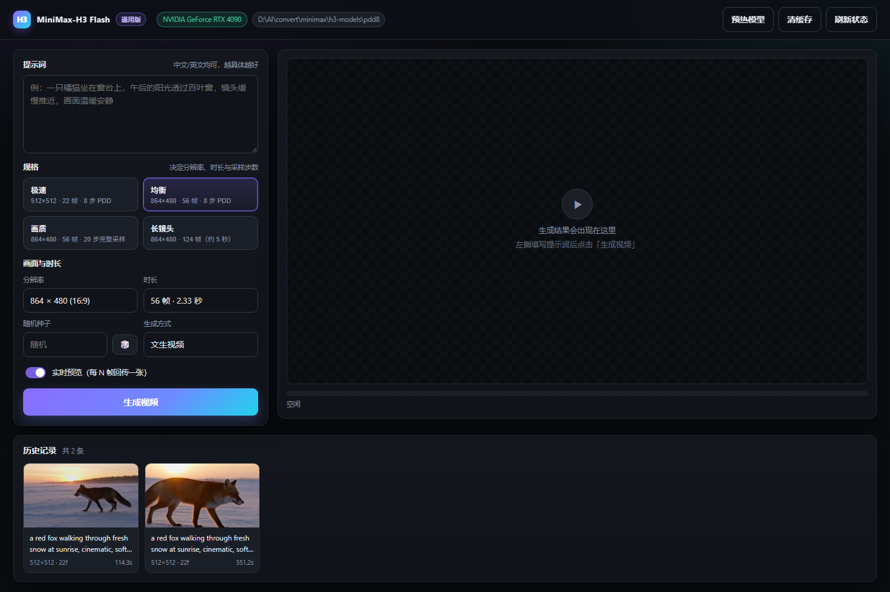
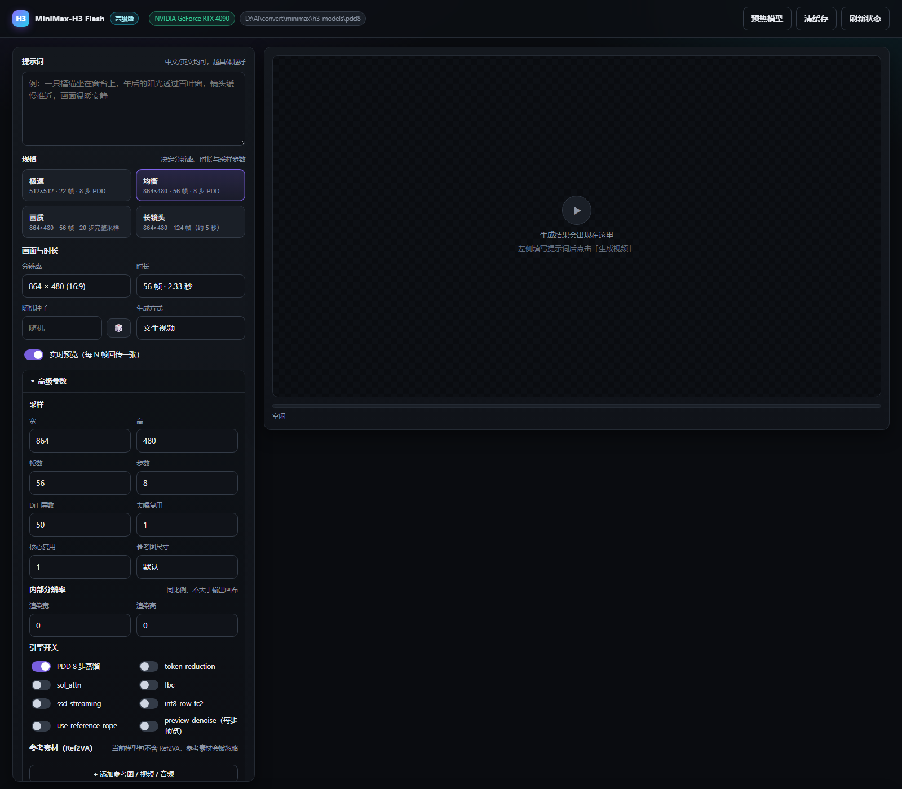

# H3 .NET Runtime (`h3rt`)

把 `ComfyUI_MiniMax-H3-V8` 的推理能力封装成**不依赖 Python 的原生运行库**，
再用 .NET 的 P/Invoke 封装供 C# 程序直接调用。基础是 `h3-spark.c`（纯 C + CUDA
的 MiniMax-H3 推理引擎），新项目位于 `h3-dotnet-runtime/`，已启用 git。

```
.NET 程序 (C#)                   浏览器 (通用版 / 高级版 WebUI)
   │  P/Invoke (cdecl, UTF-8 JSON, 回调委托)      │ HTTP + JSON
   ▼                                              ▼
H3NetRuntime.dll  ── SafeHandle / async / IProgress / CancellationToken
   │                                              ▲
   │                                    H3NetRuntime.WebUI (ASP.NET Core)
   ▼
h3rt.dll / libh3rt.so   ← 本项目新增的 C ABI 层 (src/h3rt.c)
   │
   ├── native/engine/   ← vendored h3-spark.c 源码快照 (rev a474eca, v0.2.3)
   │     h3.c / h3_dit.c / h3_gpu.cu / platform/win32 / cJSON
   └── 外部依赖：CUDA runtime、FFmpeg、模型权重（无 Python / 无 ComfyUI）
```

## 这件事到底做了什么（以及没做什么）

`ComfyUI_MiniMax-H3-V8`（"HyperFlow H3 Flash"）的 `app.py` / `launcher.py` 是
**Pyarmor 加壳的 Python**，其可读部分只有 ComfyUI 自定义节点：
`ComfyUI-HyperFlow-Flash`、`comfyui_hyperflow_int8_nodes`（加载
`comfy.ldm.minimax.model.MiniMaxH3Model` 的 INT8/GGUF 权重、HyperFlow Sigmas、
cfg=1 的 euler 采样、FL2VA/Ref2VA 条件、VAE 解码与视频合成）。

`h3-spark.c` 是同一套 MiniMax-H3 模型栈的 C/CUDA 实现：T2VA / FL2VA /
Ref2VA、INT8 DiT、PDD 8-step、音视频 VAE、FFmpeg 封装 MP4，**全程不需要
Python**。因此本项目：

1. 把引擎源码按原样 vendored 进 `native/engine/`（未修改上游一行代码）；
2. 新增一个薄 C ABI 层 `h3rt`：JSON 请求 → `h3_load_dir` / `h3_generate`，
   进度/帧回调、取消、设备与模型信息；
3. 用 .NET `DllImport` + `SafeHandle` + 委托把 C ABI 包装成
   `H3Runtime` 类，并提供 `GenerateAsync`；
4. 附带 C 与 .NET 的 smoke test、示例程序、构建脚本、CMake、git 仓库。

**边界（请如实理解）**：加壳的 Python 代码没有被逆向或逐行移植，兼容是
**工作流能力级**的映射（见下表）；HyperFlow 的 4/6-step sigma 与 C 引擎的
PDD 8-step 不是同一套数值，不能保证逐帧一致；ComfyUI 的节点图、GGUF/LoRA
运行时切换、任意 sampler 都不在这个库里。

### ComfyUI V8 工作流 → h3rt 映射

| ComfyUI V8 节点 / 字段 | h3rt |
|---|---|
| `HyperFlowINT8Loader` / `HyperFlowGGUFLoader` (`unet_name`) | `options.model_dir`（磁盘上的模型包目录） |
| `HyperFlowSigmas` steps=8, cfg=1, euler | `request.pdd8=true`（强制 8 步 PDD 蒸馏 schedule） |
| `HyperFlowSigmas` steps=4/6 | `pdd8=false` + `steps=N`（**非等价**，仅近似） |
| `CLIPTextEncode` 正向提示词 | `request.prompt` |
| `CLIPTextEncode` 负向提示词 | 接受但忽略（cfg=1，引擎无负向分支） |
| `EmptyH3LatentImage` | `width` / `height` / `frames` |
| `KSampler` seed / steps | `seed` / `steps` |
| `LoadImage` 首尾帧 (FL2VA) | `first_frame` / `last_frame` |
| 参考图/视频/音频 (Ref2VA) | `references` 数组或 `reference_*` 简写 |
| `VAEDecode` + `VHS_VideoCombine` / 输出 | `output`（MP4，含音频）+ `on_frame` 逐帧 RGB 回调 |
| ComfyUI `/prompt` HTTP + Gradio UI | `H3NetRuntime.WebUI`（通用版 / 高级版），同样无 Python |

## 环境要求

**Windows（已实测）**

- Visual Studio 2022/2026 的 MSVC C++ 工具集 + Windows 10 SDK、CMake ≥ 3.25、Ninja
- CUDA Toolkit 13.x（或 12.x）、NVIDIA GPU。默认 `sm_89`（RTX 4090 / Ada）；
  显卡不同必须用 `-DH3_CUDA_ARCH=<cc>` 重建，否则 cubin 不匹配，内核静默返回 0
- FFmpeg / ffprobe 在 `PATH` 上（用于 MP4 音视频封装）
- .NET 8 SDK（本机 .NET 10 SDK 亦可）
- MiniMax-H3 模型包，含 `FL2VA/transformer/config.json`；
  可选 `Ref2VA/`（约 62 GiB，仅 Ref2VA 需要）

**不需要**：Python、ComfyUI、PyTorch、Gradio、任何 `.venv`。

Linux / WSL 走 `scripts/build.sh`（gcc + nvcc + ICU + OpenMP），本仓库未在
Linux 上实测。

## 构建

```bat
:: 全部（原生 DLL + .NET 解决方案），参数为 CUDA compute capability
scripts\build.cmd 89

:: 只构建原生库
scripts\build-native.cmd 89
```

```bash
bash scripts/build.sh 89
```

产物：

| 文件 | 说明 |
|---|---|
| `dist/win-x64/h3rt.dll` | 运行库（唯一需要随 .NET 程序分发的原生文件） |
| `dist/win-x64/h3rt.lib` | 导入库（C/C++ 客户端用） |
| `dist/win-x64/h3rt_smoke.exe` | C ABI 冒烟测试 |
| `dotnet/*/bin/Release/net8.0/` | .NET 类库 / 示例 / 冒烟测试 / WebUI |

解决方案 `dotnet/H3NetRuntime.sln` 包含四个项目：

| 项目 | 作用 |
|---|---|
| `src/H3NetRuntime` | P/Invoke 封装（`H3Runtime`、`SafeHandle`、`GenerateAsync`） |
| `src/H3NetRuntime.WebUI` | ASP.NET Core 本地网页界面（通用版 / 高级版） |
| `samples/H3NetRuntime.Sample` | 命令行客户端 |
| `tests/H3NetRuntime.Smoke` | 托管层冒烟测试 |

`build-native.cmd` 不调用 `vcvars64.bat`（它在受限沙箱里会查注册表），而是
从磁盘上的 MSVC / Windows SDK 目录直接推导 `PATH` / `INCLUDE` / `LIB`，更适合 CI。

## C ABI（`include/h3rt.h`）

| 函数 | 作用 |
|---|---|
| `h3rt_version` / `h3rt_abi_version` / `h3rt_build_info` | 版本与构建信息 |
| `h3rt_create(options_json, &handle, error, size)` | 加载模型元数据 + 初始化 CUDA 设备 |
| `h3rt_destroy(handle)` | 释放 |
| `h3rt_last_error(handle)` | 线程安全的错误快照（借用的指针） |
| `h3rt_device_info` / `h3rt_model_info` / `h3rt_cache_info` | JSON 自检信息 |
| `h3rt_cache_clear` / `h3rt_set_text_cache_dir` | 缓存管理 |
| `h3rt_preload(handle, request_json, error, size)` | 预读 DiT 权重（按目标画布/步数布局预热） |
| `h3rt_generate(handle, request_json, callbacks, &result_json)` | 生成 MP4，回调进度与解码帧 |
| `h3rt_cancel` / `h3rt_is_cancelled` | 协作式取消 |
| `h3rt_free_string` | 释放返回的 JSON 字符串 |

状态码见 `h3rt_status` 枚举（0 成功，负值错误）。**所有权**：`char*` /
`char**` 返回值由调用方用 `h3rt_free_string` 释放；`h3rt_last_error` 与
`h3rt_version` 返回借用指针；回调里的 `rgb` 只在回调期间有效。

生成始终在库内部 **8 MiB 栈的线程** 上运行，所以 .NET 线程池线程（1 MiB）可以
安全等待。每个 handle 同一时刻只允许一个生成（否则 `H3RT_ERR_BUSY`）。

### JSON 契约

`h3rt_create` 的 options：

```json
{
  "model_dir": "D:/AI/convert/minimax/h3-models/pdd8",
  "config": "D:/.../config/h3.config.json",
  "text_cache_dir": "D:/.../.cache/h3-text",
  "cache_enabled": true,
  "keep_dit": true
}
```

模型目录优先级：`model_dir` → `config` 的 `h3_dir` → `~/h3-models/pdd8`。

`h3rt_generate` 的 request（未知字段忽略，便于扩展）：

```json
{
  "model": "h3",
  "prompt": "A red fox walks through fresh snow ...",
  "width": 864, "height": 480, "frames": 56,
  "steps": 8, "seed": 42, "pdd8": true,
  "output": "D:/out/fox.mp4",
  "first_frame": "D:/refs/first.png",
  "last_frame": "D:/refs/last.png",
  "references": [ {"kind":"image","path":"D:/refs/ref.png"} ],
  "dit_layers": 50, "denoise_reuse": 1, "core_reuse": 1,
  "token_reduction": false, "sol_attn": false, "fbc": false,
  "preview_denoise": false, "ssd_streaming": false,
  "render_width": 0, "render_height": 0,
  "reference_image_size": "match", "keep_dit": true
}
```

`pdd8=true` 会强制 `steps=8`、`denoise_reuse=1`（引擎的硬约束）。宽高必须是
32 的倍数且乘积 ≤ 768×1344。

**帧数必须是 `17n+5`**（5、22、39、56 … 362），且对齐后不得小于 **22**
（引擎至少需要一个 22 帧的解码块）。`h3rt` 会自动向上对齐，但 UI 只提供合法值：

```text
22  39  56  73  90  107  124  141  158  175  192  209  226  243  260  277  294  311  328  345  362
```

`h3rt_generate` 成功时返回的 JSON：

```json
{"status":"ok","model":"h3","engine":"0.2.3","output":"D:/out/fox.mp4",
 "content_type":"video/mp4","width":864,"height":480,"frames":56,"fps":24,
 "sample_rate":32000,"seed":42,"seed_string":"42","elapsed_ms":12345.6,
 "frames_per_second":4.53,"bytes":1234567,"pdd8":true,
 "phases":[{"phase":"text encoder","at_ms":141.6},
           {"phase":"denoise","at_ms":407146.5}]}
```

`phases` 是引擎的阶段切换时刻（相对生成开始，毫秒），`at_ms` 相邻差值就是各阶段
耗时，可直接做性能归因；`frames_per_second` 是整条流水线的吞吐。

## .NET 用法

```csharp
using H3NetRuntime;

using var runtime = H3Runtime.Create(new H3RuntimeOptions
{
    ModelDir = @"D:\AI\convert\minimax\h3-models\pdd8",
    KeepDit = true
});

Console.WriteLine(runtime.DeviceInfoJson);

var progress = new Progress<H3Progress>(p =>
    Console.WriteLine($"{p.Phase} {p.Completed}/{p.Total}"));

H3GenerateResult clip = await runtime.GenerateAsync(
    new H3GenerateRequest
    {
        Prompt = "A red fox walks through fresh snow in a pine forest.",
        Width = 864, Height = 480, Frames = 56, Seed = 42,
        OutputPath = @"D:\out\fox.mp4",
        Pdd8 = true
    },
    progress,
    onFrame: f => Console.WriteLine($"frame {f.FrameIndex + 1}/{f.FrameCount}"),
    cancellationToken: cts.Token);

Console.WriteLine($"{clip.OutputPath} ({clip.Bytes} bytes)");
```

- `H3RuntimeException.Status` 携带原生错误码；取消抛 `OperationCanceledException`。
- `onFrame` 在原生线程回调，**不要**直接操作 UI；需要像素时设
  `captureFrames: true`（会把整帧 RGB 复制到 `H3Frame.Pixels`）。
- 原生库查找顺序：`H3RT_NATIVE_DIR` → 程序目录 → 上层 `dist/<rid>` → 当前
  目录 → 系统默认加载器；也可直接把 `h3rt.dll` 放在程序旁边。

## WebUI（通用版 / 高级版）

`dotnet/src/H3NetRuntime.WebUI` 是一个 ASP.NET Core 应用，把 `H3Runtime` 包成
本地网页界面。**没有 Python、没有 ComfyUI、没有 Gradio**，整个界面是一个静态
`wwwroot`（原生 JS，无构建步骤）+ JSON API。

```bat
scripts\run-webui.cmd            :: 通用版  -> http://127.0.0.1:7867/
scripts\run-webui-advanced.cmd   :: 高级版  -> http://127.0.0.1:7867/
```

两个脚本都接受追加参数（`--port`、`--host 0.0.0.0`、`--model-dir`、`--preload`）。
默认绑定 `127.0.0.1`，要局域网访问需显式 `--host 0.0.0.0`。

### 两版的差别

| | 通用版 `--edition general` | 高级版 `--edition advanced` |
|---|---|---|
| 提示词 / 首尾帧 / 实时预览 | ✅ | ✅ |
| 4 个规格预设（极速/均衡/画质/长镜头） | ✅ 决定采样策略 | ✅ 仅作默认值 |
| 分辨率 / 时长 / 种子 | ✅ 可改 | ✅ 可改 |
| 宽高 / 帧数 / 步数 / DiT 层数 / 复用 | 服务端按预设强制 | 全部可调 |
| 内部分辨率 `render_width/height` | 强制 0 | ✅ |
| 引擎开关（`token_reduction` `sol_attn` `fbc` `ssd_streaming` `int8_row_fc2` `use_reference_rope` `preview_denoise`） | 全部强制关闭 | 全部可调 |
| 有序参考素材（Ref2VA：图/视频/音频混排） | ❌ | ✅ |
| 切换模型包 / 手动预热 / 清缓存 | 预热、清缓存 | 全部 |
| 阶段耗时表 / 原始 JSON | ❌ | ✅ |

通用版的取舍是**不给用户把引擎配错的机会**：采样参数由预设锁定，服务端还会
二次校验（32 的倍数、像素上限、帧数 `17n+5`、PDD 必须是 8 步），非法请求直接
返回 400 而不是让 CUDA 跑十分钟后失败。

### 后端行为

- **单实例常驻**：一个 `H3Runtime`（一个 CUDA 上下文、一份 DiT 驻留），所有任务
  串行排队。引擎同一时刻只能跑一个生成，并发没有意义，只会互相抢显存。
- **实时预览**：帧回调只把像素丢进一个容量 1 的 `Channel`（`DropOldest`），
  由独立线程降采样成 PNG 落盘。**慢磁盘或慢编码不会拖慢 CUDA 流水线**，旧帧
  自动丢弃，永远只渲染最新一帧。
- **取消**：`CancellationToken` → `h3rt_cancel`，在下一个引擎回调点生效；
  排队中的任务直接标记取消，不占用 GPU。
- **历史**：`work/history.json`（原子写），只存摘要，上限 60 条。

### HTTP API

| 方法 | 路径 | 说明 |
|---|---|---|
| GET | `/api/config` | 版本、预设、分辨率、帧数表、模型包列表（不碰引擎） |
| GET | `/api/status` | 设备/模型/缓存 JSON（首次调用会加载模型元数据） |
| POST | `/api/generate` | 入队生成，返回 `202` + `JobView` |
| GET | `/api/jobs/{id}` | 任务快照（状态/进度/预览/结果） |
| GET | `/api/jobs` | 排队中与运行中的任务 |
| POST | `/api/jobs/{id}/cancel` | 取消 |
| GET | `/api/history` | 历史摘要 |
| POST | `/api/upload` | 上传参考素材（白名单扩展名，≤512 MB） |
| POST | `/api/preload` | 按当前画布预热 DiT，返回耗时 |
| POST | `/api/model/select` | 切换模型包（仅高级版，且必须空闲） |
| POST | `/api/cache/clear` | 清空常驻缓存 |
| GET | `/files/outputs/...`、`/files/uploads/...` | 静态文件（MP4 / PNG） |

`/api/generate` 的请求体就是 `H3GenerateRequest` 的字段（camelCase），额外支持
`preset`、`livePreview`、`previewEvery`、`modelDir`。校验失败返回
`{"error": "..."}` + 400，引擎忙返回 503。

| 通用版 | 高级版 |
|---|---|
|  |  |

## 性能

所有加速都在引擎侧（本项目没有改上游一行代码），`h3rt` 做的是**不浪费**：

| 手段 | 说明 |
|---|---|
| `keep_dit=true` | 生成后保留 DiT 映射，下一次只付 VAE 的代价 |
| `h3rt_preload` | 按目标画布/步数布局预读权重，把首帧前的等待提前到"点生成"之前 |
| 常驻 `H3Runtime` | 一次 `h3_create`，进程内复用 CUDA 上下文与文本编码器 |
| 内存 embedding 缓存 | 同一提示词第二次生成直接跳过文本编码（`cache_info.embedding_entries`） |
| `text_cache_dir` | 可选的磁盘缓存，跨进程复用提示词 embedding |
| `phases` / `frames_per_second` | 结果里直接给阶段耗时与吞吐，便于定位瓶颈 |

RTX 4090 / 512×512 / 22 帧 / PDD 8 步的实测（同一进程、同一提示词）：

| 阶段 | 冷启动 | 热启动 |
|---|---:|---:|
| text encoder（含 26 GB 权重读取） | 204.7 s | — |
| refine text + precompute AdaLN | 29.3 s | — |
| load transformer core（21 GB） | 173.0 s | — |
| denoise（8 步） | 16.5 s | 2.3 s |
| audio VAE | 2.6 s | 5.2 s |
| video VAE decode | 122.3 s | 105.2 s |
| FFmpeg 封装 | ~2 s | 1.6 s |
| **合计** | **551 s** | **114 s** |

结论很直接：**冷启动几乎全花在读权重上（约 380 s / 70%）**，热启动后瓶颈变成
video VAE 解码。所以常驻服务 + `preload` 是这套引擎唯一有意义的用法；
`--preload` 或启动后点一次「预热模型」，之后每次生成只等 VAE。

## 验证

```bat
:: C ABI（不需要模型；加模型目录会额外做设备/模型自检）
dist\win-x64\h3rt_smoke.exe D:\AI\convert\minimax\h3-models\pdd8

:: 托管层（设置 H3_MODEL_DIR 可额外验证真实模型加载）
set H3_MODEL_DIR=D:\AI\convert\minimax\h3-models\pdd8
dotnet run --project dotnet\tests\H3NetRuntime.Smoke -c Release

:: 端到端生成（会耗时数分钟；帧数必须 17n+5 且 ≥ 22）
dotnet run --project dotnet\samples\H3NetRuntime.Sample -c Release -- ^
  --model-dir D:\AI\convert\minimax\h3-models\pdd8 ^
  --prompt "A red fox walks through fresh snow." --width 512 --height 512 ^
  --frames 22 --out D:\out\fox.mp4

:: WebUI 冒烟（另开一个窗口）
scripts\run-webui-advanced.cmd
curl http://127.0.0.1:7867/api/config
curl -X POST http://127.0.0.1:7867/api/generate -H "Content-Type: application/json" ^
  -d "{\"prompt\":\"a red fox in snow\",\"preset\":\"turbo\"}"
```

本机实测（RTX 4090 / `sm_89` / CUDA 13.3）：

- `h3rt_smoke` 全部通过，读到 `FL2VA` 各组件清单与 GPU 信息；
- 托管 smoke test 全部通过（ABI、build info、缺失模型包报错、缓存、取消）；
- WebUI 端到端跑通：`512×512 / 22 帧 / 8 步 PDD` 输出
  `h264 512×512 24fps 22 帧 + aac 32 kHz` 的 MP4，实时预览与封面 PNG 正常。

## 部署清单

1. `h3rt.dll`（及 `cudart64_*` / `cublas64_*` / `cublasLt64_*` 等 CUDA 运行库）
   与你的 .NET 程序放同一目录，或设置 `H3RT_NATIVE_DIR`。
2. FFmpeg / ffprobe 在 `PATH` 上。
3. 模型权重目录（或 `h3.config.json`）随程序提供；权重受 MiniMax-H3 /
   HyperFlow 的 Hugging Face 许可约束，**本仓库不含权重**。
4. 目标机器的 GPU compute capability 必须与构建时的 `H3_CUDA_ARCH` 一致。
5. 只部署 WebUI 时：

   ```bat
   dotnet publish dotnet\src\H3NetRuntime.WebUI -c Release -r win-x64 --self-contained false ^
     -o publish\webui
   copy dist\win-x64\h3rt.dll publish\webui\
   ```

   `wwwroot` 与 `appsettings.json` 会随发布一起输出；运行时 `work/` 目录在
   **当前工作目录**下创建（可用 `--output` 指定绝对路径）。

## 已知限制

- 加壳 Python 应用未逆向；映射是工作流能力级，不保证与 ComfyUI 输出逐像素一致。
- 只服务 MiniMax-H3 / HyperFlow H3 Flash 流水线；`h3-spark.c` 的 Z-Image /
  Wan2.2 / Qwen-Image 2.1 未通过本 ABI 暴露（可用上游 `h3 serve`）。
- 单个 handle 串行生成；`h3rt_cancel` 是协作式，**在阶段边界生效**：取消请求会
  让回调立刻停止上报，但引擎要等当前阶段（文本编码 / 权重读取 / 去噪 / VAE）
  跑到下一个检查点才真正中止。冷启动时取消文本编码阶段最坏要等它跑完。
- 输出是文件路径（MP4），不通过 ABI 回传大块字节；帧像素走回调。
- 冷启动约 9 分钟（读 47 GB 权重），必须靠常驻进程 + 预热摊薄；单次调用场景
  不适合这套引擎。
- WebUI 的任务状态靠轮询（约 550 ms），没有做 SSE/WebSocket；单机自用足够，
  多人协作需要换成消息推送并加队列优先级。
- Linux 构建路径未在本机实测。

## 许可与来源

- `native/engine/`：上游 `h3-spark.c` (rev `a474eca`, v0.2.3) 源码快照，
  见 [`native/engine/ORIGIN.md`](native/engine/ORIGIN.md)、`LICENSE`、
  `THIRD_PARTY_NOTICES.md`。原始项目 `antirez/h3.c`。
- 本项目新增代码：`include/h3rt.h`、`src/`、`.NET` 项目、脚本与文档。
- 模型权重不包含在仓库中。
